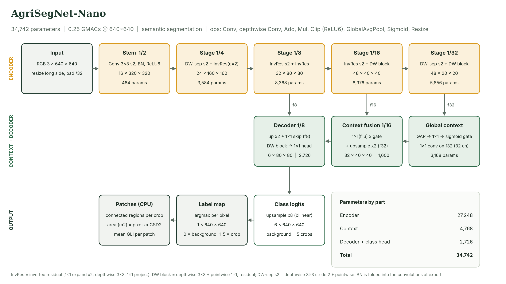
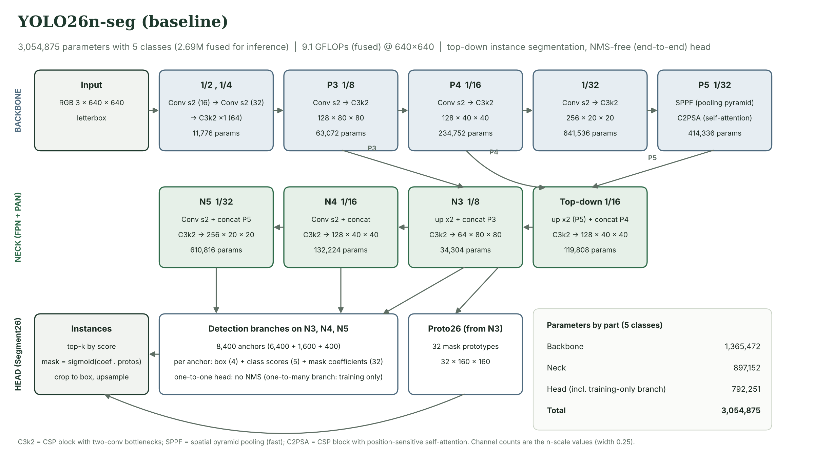

# AgriSegNet-Nano: design description

Companion to `agriseg/agrisegnet.py` (class `AgriSegNetNano`).
All parameter counts, MAC counts and tensor shapes below were measured from the code. Measurement conditions:

* input 640 x 640;
* 6 output classes: background + fenugreek, gram, linseed, potato, wheat;
* width multiplier 1.0;
* BatchNorm counted separately (it is folded into the convolutions at export).



---

## 1. Design requirements

The model was designed backwards from the deployment constraints, not forwards from an existing backbone.

| # | Requirement | Where it comes from | Design consequence |
|---|---|---|---|
| R1 | **< 50,000 parameters** | project brief | No standard backbone fits (section 3); every channel and block is budgeted by hand. |
| R2 | **Runs on any edge device**: microcontroller, Raspberry Pi, Jetson Nano / Orin | the device is not fixed in advance | Only operators that every runtime supports, including TFLite-Micro and NPU compilers (section 2.2). |
| R3 | **Shares the device with other scheduled tasks** | flight-control, logging and capture run on the same board | Low compute (0.24 GMACs) and low working memory (section 6), so it does not starve other processes. |
| R4 | **INT8 deployment without accuracy loss** | MCUs and NPUs are integer-only; INT8 also cuts memory 4x | Bounded activation (ReLU6), BatchNorm folded into the convolutions, no hard-to-quantise layers. Measured: mIoU 0.798 in both FP32 and INT8 at 640 px. |
| R5 | **Match the structure of the task** | 5 crops in UAV RGB at 25 m (4.7 cm/px after resize to 640) | Crop identity comes from colour and texture over large areas, not from fine shape. Capacity goes into receptive field and context, not high-resolution detail (section 2.1). |
| R6 | **Per-field output (like YOLO), when needed** | area and GLI are reported per field | Optional 2.3k-parameter boundary head plus grouping outside the network (section 5). |
| R7 | **Trainable from scratch** | no pre-trained weights exist at this size; the YOLO baseline was also trained from scratch for fairness | Kaiming initialisation, auxiliary supervision, Dice + cross-entropy loss, strong augmentation (section 7). |

### 2.1 What the task needs

* **Fields are large and contiguous.** One field covers thousands of pixels. Classification errors inside a field matter far more than the exact position of its edge.
* **Crops differ in colour and texture, not in object shape.** Wheat vs potato is decided by canopy texture, row pattern and tone over a patch of several metres. That favours a **large receptive field** over many channels at full resolution.
* **Predicting at 1/8 resolution is enough** for crop type: one output cell is 8 x 8 px, about 38 x 28 cm on the ground at 640 px. Upsampling the output bilinearly then gives smooth class boundaries.
* **Whole-image context helps.** A frame that is mostly wheat rarely contains a tiny isolated potato patch. A global-context gate (section 4.3) gives every pixel that information at almost no cost.

### 2.2 Operator set (device-agnostic)

After BatchNorm folding, the exported graph contains only:

| Operator | Used for |
|---|---|
| Conv (dense 3x3, depthwise 3x3, pointwise 1x1) | all feature extraction |
| Clip(0, 6) | ReLU6 activation |
| Add | residual connections, feature fusion |
| Mul | context gate |
| GlobalAveragePool | context gate |
| Sigmoid | context gate (one 32-value vector per image) |
| Resize (bilinear, fixed integer factors 2, 4, 8) | decoder upsampling |

**Deliberately excluded:**

| Excluded | Why |
|---|---|
| SiLU / Swish / hard-swish | unbounded or piecewise activations quantise worse than ReLU6, and some MCU kernels lack them |
| Attention (MatMul, Softmax) | quadratic memory in image size; poorly supported or slow on MCUs and many NPUs |
| Dilated convolutions | not supported by several NPU compilers; slow on MCUs |
| Concat | adds memory copies and needs explicit buffer planning on MCUs; Add is used for all fusion instead |
| MaxPool | not needed: downsampling is by strided convolution |
| Dynamic shapes, Shape/Slice ops | MCU and NPU compilers need a fully static graph; all resize factors are fixed integers, and input sides must be multiples of 32 |
| Squeeze-and-excitation inside blocks | extra per-block pooling and sigmoid; one global gate is used instead |

---

## 3. Choice of backbone

### 3.1 Why not a standard backbone

* **Too big:** even the narrowest ImageNet backbones in common use (MobileNetV2/V3, EfficientNet-Lite, ShuffleNet at their smallest width settings) carry roughly hundreds of thousands of parameters or more in the feature extractor alone. That is an order of magnitude above the 50k budget before any decoder is added.
* **Shrinking one doesn't work well:**
  * Shrinking those designs further leaves channel counts below 8, where the 1x1 convolutions become a bottleneck and the block design no longer works as intended.
  * Their stages are proportioned for ImageNet (224 px, 1000 classes): most parameters sit in the deepest, widest layers. A 6-class segmentation task does not need that.
* **No pretraining benefit:** pre-trained weights could not be used anyway. Under R7 both models were trained from scratch.

### 3.2 What was taken from existing designs

The building blocks are proven designs from mobile networks; only their sizes and arrangement are new.

| Borrowed idea | Source family | Why it suits this budget |
|---|---|---|
| Depthwise-separable convolution (depthwise 3x3 + pointwise 1x1) | MobileNetV1 | Cuts the parameters and MACs of a 3x3 convolution by about 8–9x at these channel counts |
| Inverted residual with linear bottleneck | MobileNetV2 | Expands channels inside the block (more capacity for the depthwise filter) and keeps a narrow, linear output, so the residual path keeps information |
| ReLU6 | MobileNetV1/V2 | Bounded range [0, 6], so INT8 scales are easy to fix |
| Width multiplier with channels rounded to multiples of 8 | MobileNet / EfficientNet | Channel counts align with SIMD and NPU vector widths |
| Global-pooling context | ParseNet / BiSeNet-style attention refinement | Image-wide context for 1.6k parameters, without attention |
| Auxiliary head on intermediate features | PSPNet-style deep supervision | Stabilises from-scratch training of a very thin network; removed at export |

### 3.3 Where the parameters and compute go

| Module | Output (640 input) | Params | % params | MMACs | % MACs |
|---|---|---:|---:|---:|---:|
| stem | 16 x 320 x 320 (1/2) | 464 | 1.3 | 44.2 | 18.1 |
| stage4 | 24 x 160 x 160 (1/4) | 3,584 | 10.3 | 83.6 | 34.2 |
| stage8 | 32 x 80 x 80 (1/8) | 8,368 | 24.1 | 72.0 | 29.4 |
| stage16 | 48 x 40 x 40 (1/16) | 8,976 | 25.8 | 23.3 | 9.5 |
| stage32 | 48 x 20 x 20 (1/32) | 5,856 | 16.9 | 2.2 | 0.9 |
| context fusion (ctx16, ctx32, gate) | 32 x 40 x 40 | 4,768 | 13.7 | 3.1 | 1.3 |
| decoder (low, refine) | 32 x 80 x 80 | 2,528 | 7.3 | 15.0 | 6.1 |
| head | 6 x 80 x 80 | 198 | 0.6 | 1.2 | 0.5 |
| **Total (deployed, semantic)** | 6 x 640 x 640 after x8 upsample | **34,742** | 100 | **244.6** | 100 |
| auxiliary head (training only) | 6 x 40 x 40 | 294 | — | — | — |
| boundary head (optional, section 5) | 1 x 640 x 640 | 2,305 | — | 54.1 | — |
| **Total with boundary head** | 7 x 640 x 640 | **37,047** | | **298.6** | |

The figures show a deliberate split:

* **Compute sits at high resolution.** The stem, stage4 and stage8 hold 82% of the MACs but only 36% of the parameters. They are cheap in weights but run over many pixels.
* **Parameters sit at low resolution.** Stage16, stage32 and the context modules hold 56% of the parameters but only 12% of the MACs. This is where the capacity for recognising crops lives, and at 1/16–1/32 resolution it is almost free in compute.

---

## 4. Operations through the model (semantic path)

Shapes are given for a 640 x 640 RGB input. "Conv-BN-ReLU6" means convolution, then batch norm (folded at export), then ReLU6.

### 4.1 Encoder

| Stage | Block | Operations | Output |
|---|---|---|---|
| **stem** | ConvBNAct | 3x3 conv, stride 2, 3 -> 16, BN, ReLU6 | 16 x 320 x 320 |
| **stage4** | DWBlock (s2) | depthwise 3x3 stride 2 (16 ch), BN, ReLU6 -> pointwise 1x1 16 -> 24, BN, ReLU6 | 24 x 160 x 160 |
| | InvertedResidual (s1, x2) | 1x1 24 -> 48, BN, ReLU6 -> depthwise 3x3 (48), BN, ReLU6 -> 1x1 48 -> 24, BN (linear) -> **+ input** | 24 x 160 x 160 |
| **stage8** | InvertedResidual (s2, x2) | 1x1 24 -> 48 -> depthwise 3x3 stride 2 -> 1x1 48 -> 32 (linear) | 32 x 80 x 80 |
| | InvertedResidual (s1, x2) | 1x1 32 -> 64 -> depthwise 3x3 -> 1x1 64 -> 32 (linear) -> **+ input** | 32 x 80 x 80 |
| **stage16** | InvertedResidual (s2, x2) | 1x1 32 -> 64 -> depthwise 3x3 stride 2 -> 1x1 64 -> 48 (linear) | 48 x 40 x 40 |
| | DWBlock (s1) | depthwise 3x3 (48) -> pointwise 1x1 48 -> 48 (linear) -> **+ input** | 48 x 40 x 40 |
| **stage32** | DWBlock (s2) | depthwise 3x3 stride 2 -> pointwise 48 -> 48, ReLU6 | 48 x 20 x 20 |
| | DWBlock (s1) | depthwise 3x3 -> pointwise 48 -> 48 (linear) -> **+ input** | 48 x 20 x 20 |

**Design notes.**

* **Dense stem.** With only 3 input channels, a depthwise convolution would hold just 27 weights and could not mix the colour channels. A dense 3x3 is the right choice at that point; it is 464 parameters.
* **Expansion ratio 2, not MobileNetV2's 6.** At these widths, ratio 6 would spend most of the budget on 1x1 expansions at high resolution. Ratio 2 keeps the inverted-residual benefit at a third of the cost.
* **Two block types.**
  * Inverted residuals are used where the network changes width or must build new features (stage4–stage16).
  * Plain depthwise-separable blocks (no expansion) are used where the width stays at 48 (stage16–stage32). Extra depth is cheaper than extra width there.
* **Linear outputs on residual blocks.** The last 1x1 in a residual block has no activation (the MobileNetV2 linear bottleneck). Applying ReLU to a narrow 24–48-channel tensor before the addition would discard information that cannot be recovered.
* **Receptive field.** The theoretical receptive field at the 1/32 stage is 183 x 183 px, about 8.7 x 6.5 m on the ground at 640 px; the global gate (4.3) adds whole-image context on top. The effective receptive field of any CNN is smaller than the theoretical one.

### 4.2 Why stop the encoder at 1/32 with only 48 channels

At 1/32 a 640 px frame is 20 x 20 cells. Each cell summarises a 32 x 32 px patch (about 1.5 x 1.1 m) and, through the stacked convolutions, sees a much wider neighbourhood. Going wider (more channels) would multiply parameters, since 1x1 convolutions cost cin x cout. Going deeper (1/64) would leave a 10 x 10 grid, too coarse to locate small fields such as fenugreek.

### 4.3 Context fusion (1/16 and 1/32)

```
ctx16 = Conv1x1-BN-ReLU6(f16)          48 -> 32 ch, 40 x 40
gate  = Sigmoid(Conv1x1(GAP(f32)))      48 -> 32 values, one per channel, for the whole image
ctx32 = Conv1x1-BN(f32)                 48 -> 32 ch, 20 x 20 (linear)
ctx   = ctx16 * gate + Upsample2x(ctx32)               32 x 40 x 40
```

* **The gate (1,568 parameters)** averages the deepest features over the whole image to a 48-value summary of the scene, maps it to 32 weights between 0 and 1, and scales each channel of the 1/16 features.
  * Channels that are irrelevant to the scene are suppressed; relevant ones are kept.
  * This is channel attention computed once per image. It costs one pooling, one 1x1 convolution and one sigmoid on 32 values, not attention over pixels.
* **The addition of ctx32** brings in the coarser, wider-context 1/32 features.
* Fusion is by **Add, not Concat**, so the channel count does not grow and no buffer copy is needed.

### 4.4 Decoder (1/8) and output

```
d8  = DWBlock( Upsample2x(ctx) + Conv1x1-BN(f8) )       32 x 80 x 80
out = Conv1x1( Dropout2d(d8) )                          6 x 80 x 80    (dropout 0.05, training only)
out = Upsample8x_bilinear(out)                          6 x 640 x 640  (class logits)
```

* **Skip connection from stage8.** The 1x1 projection of f8 brings back spatial detail lost in the 1/16–1/32 path, which matters for field boundaries.
* **Prediction at 1/8, then a single bilinear x8 upsample.** A full U-Net-style decoder back to 1/1 would add the network's largest tensors for little gain, given 4.7 cm pixels and field-scale classes. The model already reaches 0.962 pixel accuracy.
* **Optional `output_stride = 8` mode.** The model can emit the 6 x 80 x 80 logits directly; the device takes the argmax and enlarges the label map with nearest-neighbour. This removes the largest tensor in the network (6 x 640 x 640) and is the intended mode for microcontrollers.
* **Auxiliary head (training only).** A 1x1 convolution on f16 (48 -> 6), upsampled 16x and supervised with the same loss at weight 0.4. It gives the middle of the network a direct training signal, which helps a very thin network trained from scratch. It is dropped at export and costs nothing at inference.

---

## 5. Optional boundary head: per-field (instance) output

A semantic model labels every wheat pixel "wheat" but cannot tell two adjacent wheat fields apart. To report area and GLI **per field**, as YOLO does, an optional head predicts field boundaries:

```
b = Upsample2x(d8) + Conv1x1-BN(f4)        32 x 160 x 160  (1/4 resolution, uses stage4 detail)
b = DWBlock(b)                              32 x 160 x 160
b = Conv1x1(b)                              1 x 160 x 160   (boundary logit)
b = Upsample4x(b)                           1 x 640 x 640
output = Concat(class logits, boundary)     7 x 640 x 640   (single static output)
```

* **Cost:** +2,305 parameters (total 37,047) and +54 MMACs (total 0.30 GMACs). It runs at 1/4 resolution because boundaries need finer detail than class labels.
* **Grouping happens outside the network**, as CPU post-processing (`instances.group_instances`; its run time has not been benchmarked yet):
  1. take the connected regions of each class;
  2. if the predicted boundary cuts a region into two or more sufficiently large parts, split it with a watershed;
  3. score each field by the mean class probability over its pixels.
* **Why bottom-up rather than YOLO-style.** YOLO detects boxes, then predicts per-box mask coefficients, then suppresses duplicates. Nano predicts a label map plus boundaries and groups them. This keeps the network static, small and free of box regression, and fits large, irregular, touching fields better than axis-aligned boxes.
* **Training target:** a 3-pixel-wide band along each annotated field polygon edge. The loss is weighted binary cross-entropy (positive weight 5, because boundary pixels are a few percent of the image) plus soft Dice, at weight 1.0 relative to the segmentation loss.

**Still a semantic model?** The network itself outputs per-pixel class and boundary maps. Together with the grouping step, the system outputs instances (one mask, class and score per field), evaluated with COCO mask AP like YOLO. It is fair to call it a *bottom-up instance segmentation* model.

---

## 6. Memory and deployment footprint

| | AgriSegNet-Nano | YOLO26n-seg |
|---|---|---|
| Weights, INT8 | ~34 KB | ~2.7–3 MB |
| Weights, FP32 | ~136 KB | ~11–12 MB |
| Peak activation memory, INT8 (lower bound) | 0.44 MiB @ 256, 0.68 MiB @ 320, 2.73 MiB @ 640 | not measured |
| Compute @ 640 | 0.24 GMACs (0.30 with boundary head) | ~4.5 GMACs (9.1 GFLOPs fused, as Ultralytics reports) |
| CPU latency, 1 thread @ 640 (measured) | 19.6 ms | 109.5 ms |

* **Peak activation memory, not parameter count, decides whether a model fits a microcontroller.** It is the largest pair of tensors that must be in memory at the same time. At 256–320 px Nano needs under 0.7 MiB, within reach of high-end microcontrollers with external or large on-chip SRAM. At 640 px it needs an application-class processor (Pi, Jetson), which also has headroom for other tasks.
* **These are lower bounds.** The real arena size depends on the runtime's memory planner, and MCU latency has not been measured yet.

---

## 7. Training recipe

| Item | Setting | Why |
|---|---|---|
| Initialisation | Kaiming normal (fan-out), zero biases | standard for ReLU-family networks trained from scratch |
| Loss (semantic) | cross-entropy + Dice (weight 1.0) | Dice counteracts class imbalance: wheat dominates the pixels, fenugreek is rare |
| Auxiliary loss | same, on f16, weight 0.4 | deep supervision for a thin network |
| Boundary loss | weighted BCE (positive weight 5) + soft Dice, weight 1.0 | boundary pixels are rare |
| Optimiser | AdamW, lr 2e-3, weight decay 1e-2 (not on BN/bias) | robust for small networks; no decay on normalisation parameters |
| Schedule | 3-epoch linear warm-up, cosine decay to 1% of lr | stable start from scratch |
| Weight averaging | EMA of weights | smoother validation curve, better final model |
| Mixed precision | yes (AMP) on GPU | speed only |
| Epochs / stopping | up to 300, early stopping with patience 50 on validation mIoU | the same protocol as the YOLO baseline; best epoch 173 of 223 |
| Input | 640 x 640 (Roboflow resize), batch 16 | same as the YOLO baseline |
| Geometric augmentation | scale 0.6–1.6, rotation by any multiple of 90° ±20°, horizontal flip, random translation | UAV imagery has no "up"; scale covers altitude changes |
| Photometric augmentation | brightness/contrast, gamma, hue ±6, saturation 0.7–1.3, motion blur (20%), sensor noise (20%) | changing light, platform vibration, low-cost camera noise |

---

## 8. Comparison with YOLO26n-seg



### 8.1 Architecture

| Aspect | AgriSegNet-Nano | YOLO26n-seg |
|---|---|---|
| Task formulation | per-pixel classification (+ optional boundaries), grouped into fields after the network | detection of boxes, then a mask per detected object |
| Parameters | 34,742 (37,047 with boundary head) | 3,054,875 for 5 classes (2.69 M after fusing for inference); backbone 1.37 M, neck 0.90 M, head 0.79 M |
| Backbone blocks | depthwise-separable and inverted residuals (expansion 2), ReLU6 | dense 3x3 Conv-BN-SiLU, C3k2 (cross-stage-partial bottlenecks), SPPF (cascaded 5x5 max-pooling), C2PSA (multi-head self-attention) |
| Channels at 1/8, 1/16, 1/32 | 32, 48, 48 | 64, 128, 256 |
| Neck | one gated context fusion (Add) plus one skip from 1/8 | full FPN + PAN: top-down and bottom-up paths with nearest upsampling and Concat at three scales |
| Global context | global-average-pool channel gate (one vector per image) | self-attention at 1/32 (C2PSA) + SPPF pooling |
| Head | 1x1 classifier at 1/8, bilinear x8 | per scale (1/8, 1/16, 1/32): box regression, class scores and 32 mask coefficients; end-to-end one-to-one assignment, so no NMS is needed |
| Mask generation | the class map *is* the mask | 32 prototype masks at 1/4 (160 x 160) from fused P3–P5 features; each object's mask = sigmoid(coefficients · prototypes), cropped to its box, then upsampled |
| Training-only parts | auxiliary head on f16 | semantic-segmentation branch in Proto26 (removed when fused) |
| Activation | ReLU6 (bounded) | SiLU (unbounded) |
| Operators | Conv, Add, Mul, Clip, GAP, Sigmoid, Resize | adds MaxPool, Concat, Split, MatMul, Softmax, SiLU (Sigmoid x Mul), box decoding, top-k selection |
| Output | fixed tensor: 6 (or 7) x H x W | variable list of detections (box, class, score, 32 coefficients) + prototype tensor; masks are assembled after the network |

### 8.2 What the differences mean in practice

1. **Formulation.**
   * YOLO is built for objects with clear extents (cars, people) and adapted to masks: it must find each object as a box first.
   * Crop fields are large, irregular and touching, often wider than the frame. A box is a poor description of them.
   * Nano treats the task as "what crop is at each pixel", the natural formulation for land-cover mapping. It adds boundaries only to separate fields.
2. **Capacity.**
   * YOLO has 88x more parameters and about 18x more compute. Part of that capacity goes to localising objects of any size and shape (box regression, multi-scale heads, prototype masks).
   * Our task needs less of that, which is why a 35k-parameter model gets within 0.08 mIoU.
   * The remaining gap is real, though, and concentrated in the visually similar or small classes: fenugreek 0.53 vs 0.68, gram 0.78 vs 0.86 IoU. Narrow channels limit how many fine texture cues the network can tell apart.
3. **Deployability.** Nano's graph is static, attention-free and needs no post-processing inside the network. It compiles as-is for TFLite-Micro, TensorRT, OpenVINO or an NPU. YOLO needs attention and Concat support, variable-length outputs and mask assembly afterwards, which rules out most microcontrollers and complicates NPU deployment.
4. **Quantisation.** Both models held their accuracy in INT8 at 640 px. At 320 px Nano lost 0.03 mIoU in INT8 against YOLO's 0.003: with so few channels, each quantisation error weighs more.

### 8.3 Measured results (test set, 18 images, one seed)

| | Nano FP32 | Nano INT8 | YOLO FP32 | YOLO INT8 |
|---|---|---|---|---|
| mIoU (crops) @ 640 | 0.798 | 0.798 | 0.873 | 0.870 |
| mIoU @ 480 | 0.771 | 0.778 | 0.872 | 0.872 |
| mIoU @ 320 | 0.740 | 0.710 | 0.864 | 0.861 |
| CPU latency @ 640, 1 thread | 19.6 ms | — | 109.5 ms | — |

Per-class IoU at 640, Nano / YOLO:

| Class | Nano | YOLO |
|---|---:|---:|
| fenugreek | 0.53 | 0.68 |
| gram | 0.78 | 0.86 |
| linseed | 0.78 | 0.92 |
| potato | 0.94 | 0.95 |
| wheat | 0.96 | 0.97 |

INT8 latency on desktop ONNX Runtime CPU is not representative of edge INT8 hardware and is not quoted.

---

## 9. Known weaknesses and next steps

| Weakness | Evidence | Possible remedy |
|---|---|---|
| Small and rare classes | fenugreek 0.53 IoU | class-balanced sampling, tile-based training (option B) for more pixels per small field, width 1.25 if the budget is relaxed |
| Low-resolution robustness in INT8 | −0.03 mIoU at 320 px | quantisation-aware training; per-channel scales (already used for Conv); train at 320 if that is the deployment size |
| 1/8 prediction limits edge accuracy | boundaries are drawn from 38 x 28 cm cells | the boundary head (1/4) partly addresses this; measure the per-field mask AP once that run is available |
| Single seed, 18 test images | wide bootstrap CI (−0.21 to −0.03 on the gap) | 3+ seeds, larger test set |
| On-device numbers not measured | latency and memory are from desktop CPU and analytical counts | measure on Pi 4/5, Jetson Nano/Orin and one MCU (e.g. Cortex-M7 / M55 class) |

---

## 10. One-paragraph summary

AgriSegNet-Nano is a 34,742-parameter fully convolutional segmentation network designed from the deployment constraints backwards. It has:

* a dense stem and four MobileNet-style stages (inverted residuals with expansion 2 and depthwise-separable blocks, ReLU6) reaching 1/32 resolution with 48 channels;
* a global-average-pool channel gate for whole-image context;
* a lightweight 1/8 decoder with one skip connection.

It uses only operators supported by every edge runtime, keeps the graph static, and is fully INT8-quantisable without accuracy loss at 640 px. An optional 2.3k-parameter boundary head at 1/4 resolution, plus grouping after the network, turns it into a bottom-up instance model that reports area and GLI per field.

YOLO26n-seg instead uses dense CSP blocks, self-attention, an FPN/PAN neck and box-plus-prototype masks. That is 88x the parameters and about 18x the compute, for 0.075 higher mIoU. For deployment on microcontrollers or on a device shared with other tasks, Nano is the only option of the two. Where an application-class processor is free, YOLO gives better accuracy on the small classes.
